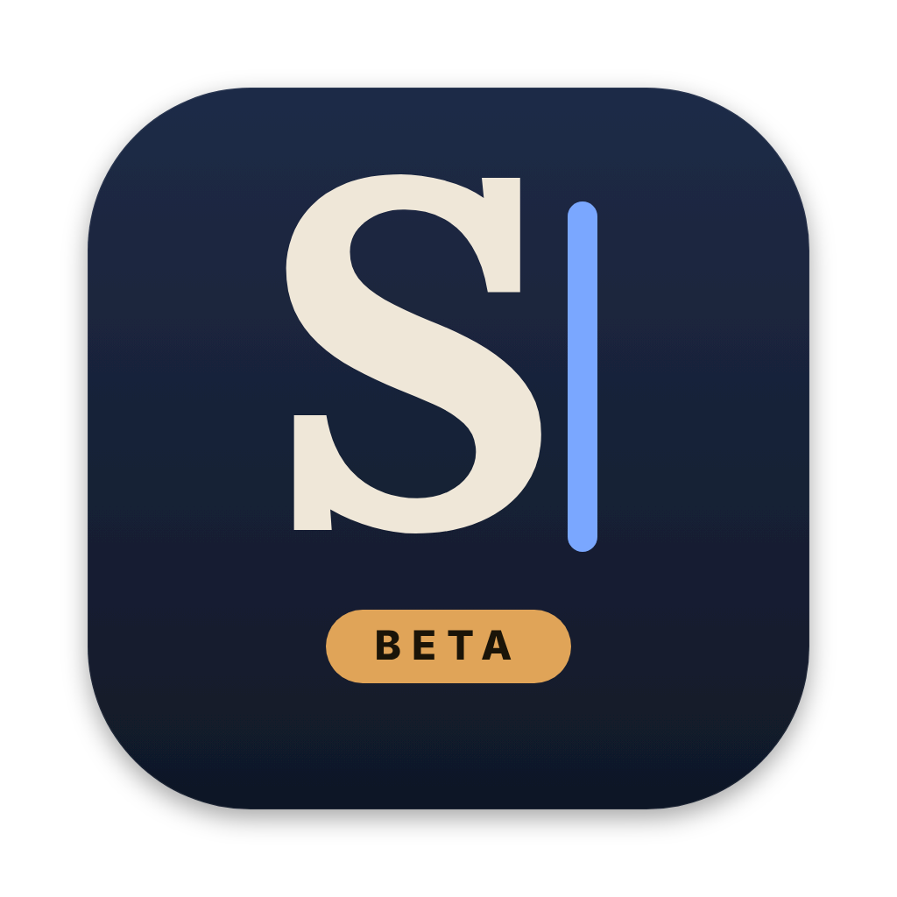

# Scripti Writer <sup>Beta</sup>

> **Early beta (current version: Beta v0.0.9).** Scripti Writer works and is ready to write in,
> but it is still changing, so you may run into bugs. Back up your stories now and then with
> **Back up all**, or let the Mac and Windows apps do it for you with automatic backups.

Scripti Writer is a free, open-source writing app for screenplays and novels: a quiet,
distraction-free place to write, with industry-standard script formatting. It runs on Mac and
Windows.

## Feedback wanted

Scripti Writer is in beta, and I'd love to hear how to make it better.

- [Share feedback or an idea](../../issues/new?template=feedback.yml)
- [Report a bug](../../issues/new?template=bug_report.yml)

## Features

- **One place per story**, with tabs in writing order: Title Page, Script (or Novel), Characters,
  Locations, Brainstorming and Corkboard. The **Settings** menu holds the cover, split screen, focus
  mode, look, backups, shortcuts and updates; the **Export** menu holds every way to export.
- **Screenplay editor** with industry formatting. Enter moves to the next line type, Tab changes it.
  Scene headings are numbered automatically ("SCENE 1. INT. LOCATION - DAY").
- **Novel editor** with chapters, scene breaks and a chapter list.
- **Page numbers** that match the printed script, and a **two-page book view** for novels and
  notes.
- **Drafts** side by side in split screen, with undo and redo. Deleting a draft can be undone.
- **Characters and locations** that fill in from the script, with colour coding. Each character
  has a card for role, gender, actor, personality, motivation, goal, and look and style with a
  five-colour palette.
- **Corkboard** and a **brainstorm board**: sticky notes, scene and character cards, shapes,
  pencil, arrows, story beats and an act timeline. The tools float at the bottom of the board, undo,
  redo and zoom at the top.
- **Title page** with produced by, copyright, date and email at the bottom.
- **Export** to PDF (industry page format), Word, Final Draft (.fdx), Fountain and text, or
  everything at once in one folder. **Import** from Fountain and Final Draft.
- **Covers**: change a story's cover image or colour, or export a PDF, right from the library.
- **Highlights and comments**, focus mode, four looks (Night, Night Warm, Light, Light Warm) with a soft glow you can turn off,
  switchable in the library too.
- Works **offline**. Stories save automatically as you type, always. The Mac and Windows apps
  finish saving before they close.
- **Find and replace** in scripts and novels. Renaming "Mara" also renames MARA.
- **Automatic backups** (Mac and Windows apps): a copy of all your stories as one file per day, in
  Documents/Scripti Writer Backups or a folder you choose. You pick how often it refreshes while
  you write (1 minute to 1 hour, 10 minutes unless you change it) and how many days to keep
  (3 to 90, 14 unless you change it). Find it under **Settings → Automatic backups and save
  folder…**.
- **Update notice**: the app tells you when a new version is out, and **Settings → Check for
  updates** asks right away. Nothing installs until you click Download.
- **About** page with the version, license, and buttons to send feedback or report a bug.

## Download and install

### [⬇ Download Scripti Writer](../../releases/latest)

Click the link above (or **Releases** on the right of this page), then the file for your computer
under **Assets**.

| System  | File                                         | Works on                      |
| ------- | -------------------------------------------- | ----------------------------- |
| Mac     | `Scripti-Writer-<version>-mac.dmg`           | Apple Silicon and Intel Macs  |
| Windows | `Scripti-Writer-<version>-windows-setup.exe` | 64-bit Windows, including ARM |

**Mac:** open the .dmg and drag Scripti Writer into Applications. The first time, macOS says it
can't verify the app: click **Done**, then go to **System Settings → Privacy & Security** and click
**Open Anyway**.

**Windows:** run the setup file. If "Windows protected your PC" appears, click **More info → Run
anyway**. It installs for your user only (no administrator rights), with Start menu and desktop
shortcuts and an uninstaller.

These warnings appear because the app is not signed with a paid Apple or Microsoft certificate.
Each release lists a SHA-256 checksum for every file, so you can check that your download is the
real one.

## Privacy

Scripti Writer has no account and no tracking, and never sends your writing anywhere. Your
stories are saved only on your device. The app loads its fonts from Google Fonts, and the Mac and
Windows apps ask GitHub for the latest version number. These are ordinary web requests that
don't include your writing. The same note is in the app under **Settings → About**.

## Important

- **Your stories stay on your computer.** Nothing is uploaded. The only thing the app asks the
  internet for is the latest version number on GitHub (for the update notice) and its fonts.
  Use **Back up all** and **Import…** in the library to move stories or keep a copy.
- **Updating never deletes your stories.** Install the new version over the old one. Uninstalling
  leaves your stories in place too. Make a backup before big updates anyway.
- **Only import backups you trust.** Imported files are cleaned so they can't run code, but a
  backup from a stranger is still a stranger's file.

## Open source

Scripti Writer is free software under the [GNU General Public License v3.0](LICENSE). You may use
it, read the code, change it and share it. If you share it, changed or not, you must share the
full source code under the same license, so every copy stays free and open.

The name **Scripti Writer** and its logo are not covered by the license; see
[TRADEMARK.md](TRADEMARK.md).

**Contributions are welcome.** Found a bug or have an idea? Open an
[issue](../../issues/new/choose). To change something yourself, fork the repository, make your
change and open a pull request. By sending a pull request you agree that your contribution is
shared under the GPL-3.0.

## Releasing a new version

1. Upload the changed files into the `Scripti` folder (keep the same folder layout).
2. Raise `"version"` in `Scripti/package.json` by one step: `0.0.6` → `0.0.7` → `0.0.8` …
   Versions before `1.0.0` are shown as betas: the release is named "Scripti Writer Beta v0.0.7"
   and tagged `v0.0.7`. `1.0.0` will be the first finished release. The update notice in the app
   compares this number with the newest release.
3. **Actions → Build installers → Run workflow**. The new version appears on the Releases page with
   its checksums, and installed copies start showing the update notice.

## Repository layout

```
Scripti/                      The app (source code, see Scripti/README.md for developer notes)
  src/                        Editor, board, exports and screens
  desktop/                    Mac and Windows app window and menu bar
  public/                     Icons and offline support
  docs/SPEC.md                Product specification
LICENSE                       GNU General Public License v3.0
TRADEMARK.md                  About the name and logo
.github/
  workflows/installers.yml    Builds the Mac .dmg and Windows .exe and publishes the release
  ISSUE_TEMPLATE/             The "Report a bug" and "Feedback or an idea" forms
```

## Building it yourself

Needs [Node.js](https://nodejs.org) 18 or newer. In the `Scripti` folder:

```bash
npm install
npm run dev     # run it in the browser at http://localhost:5173
npm run mac     # Mac .dmg (on a Mac)
npm run win     # Windows setup .exe (on Windows)
```
